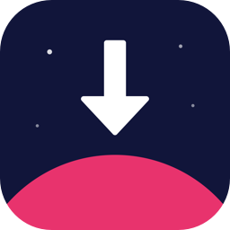

<h1 align="center">InstaSpace</h1>

Save Instagram reels, posts, stories, saved posts and whole profiles, plus your X Bookmarks and YouTube videos and playlists, on Mac, Windows, Android and iPhone.

<a href="https://github.com/xtuae/instaspace-releases/releases/latest"><b>⬇ Download the latest version</b></a> · <a href="https://xtuae.github.io/instaspace-releases/">Website</a>

---

## Features

### Instagram
| | |
|---|---|
| **Download Links** (no login) | Paste reel and post links and get full-quality videos and photos, including every carousel item |
| **Saved Posts** | Bulk-download saved posts in batches of 20 or one collection, and optionally un-save after download |
| **Stories & Highlights** | Current stories and every Highlight, without marking them as seen |
| **Profiles** | Posts, the Reels tab or Tagged: latest 10 / 20 / 30 / 50 / 100 or all |
| **Watchlist** | Accounts checked automatically for new posts and stories |
| **Multiple accounts** | Switch between signed-in accounts in one click |

### X and YouTube
| | |
|---|---|
| **X Bookmarks & links** | Latest 20 / 50 / 100 / 250 or all Bookmarks: photos at original size, videos at best quality. **Remove from Bookmarks after download**, or **Remove Downloaded** in one go |
| **YouTube** (no login) | MP4 from 360p up to 4K, M4A or MP3, with whole playlists and channels or just the first N items |

### Library and reliability
- **Never downloads twice**: a permanent history means re-runs fetch only what's new
- **Safe removal**: saved posts and bookmarks are removed only after every file is on your Mac
- **Organized folders** by site, account, collection, batch or date, with a custom filename template
- **Gallery** with Quick Look, an **Activity** log with CSV export, and **audio** extraction (.m4a)
- **Quick capture**: menu bar, drag & drop, clipboard watcher and a Safari button
- **Check for Updates**: new versions install from inside the app

## Download

| Platform | Download | Install |
|---|---|---|
| **Mac** (macOS 14+) | [InstaSpace-1.2.dmg](https://github.com/xtuae/instaspace-releases/releases/download/v1.2/InstaSpace-1.2.dmg) | Drag to Applications. First launch: System Settings → Privacy & Security → Open Anyway. Updates via *Check for Updates…* |
| **Windows** (10/11) | [InstaSpace-Setup-1.2.0.exe](https://github.com/xtuae/instaspace-windows/releases/latest/download/InstaSpace-Setup-1.2.0.exe) | Run the installer (SmartScreen: More info → Run anyway). Updates itself. |
| **Android** (8+) | [InstaSpace-1.2.apk](https://github.com/xtuae/instaspace-releases/releases/download/v1.2/InstaSpace-1.2.apk) | Open the APK and allow installing unknown apps. |
| **iPhone / iPad** | Coming soon | |

YouTube downloads are on Mac and Windows only.

---
InstaSpace is an independent app and isn't affiliated with Instagram, Meta, X or YouTube. Download only content you're allowed to keep.
